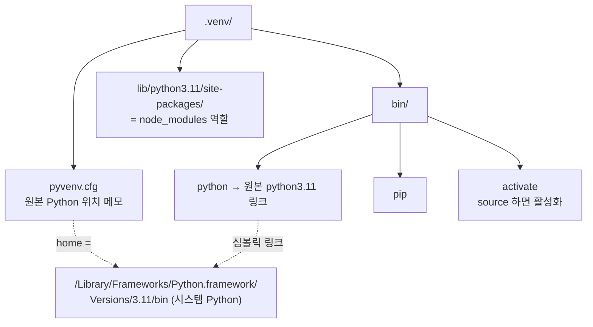
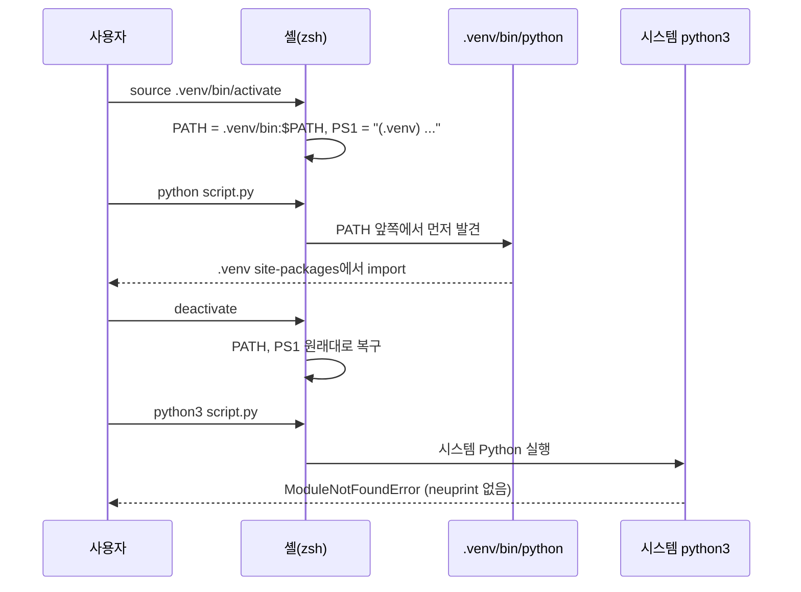

# Python 가상환경 (venv)

## 2026-09-24 — fly-connectome 프로젝트에서 `.venv`와 `.venv-1`이 둘 다 생기고, 프롬프트 앞에 `(.venv)`가 붙은 이유를 물어봄 (JS/Node 경험 기준으로 비교)

### 가상환경이 필요한 이유: Python은 기본값이 **전역 설치**

Node는 **기본 동작부터 프로젝트별 설치**다. `npm install`을 하면 현재 폴더의 `node_modules/`에 들어가고, `require`/`import`를 하면 가까운 `node_modules`부터 부모 폴더 쪽으로 올라가며 찾는다. 프로젝트끼리 따로 떨어져 있는 게 기본값이다.

Python은 반대다. 그냥 `pip install pandas`를 하면 **시스템 Python의 `site-packages`**(예: `/Library/Frameworks/Python.framework/Versions/3.11/lib/python3.11/site-packages`)에 설치되고, 그 Python을 쓰는 모든 프로젝트가 이 패키지를 같이 쓴다. 그래서 이런 문제가 생긴다.
- 프로젝트 A는 pandas 2.x, 프로젝트 B는 pandas 3.x가 필요하면 **버전 충돌**
- 전역에 이것저것 쌓여 있으니 `requirements.txt`에 빠진 패키지가 있어도 내 컴퓨터에서는 돌아가고, 다른 사람 컴퓨터에서만 깨지는 **재현성 문제**

**가상환경(venv)**은 프로젝트마다 **따로 떨어진 패키지 설치 공간**을 만들어서 Node의 기본 동작을 흉내 내는 장치다.

| JS/Node | Python |
|---|---|
| `node_modules/` (프로젝트 폴더 안) | `.venv/lib/python3.x/site-packages/` |
| `package.json` | `requirements.txt` (또는 `pyproject.toml`) |
| `npm install` | `pip install -r requirements.txt` |
| `npm i -g` (전역 설치) | 가상환경 **밖에서** 하는 `pip install` |
| (따로 필요 없음) | `source .venv/bin/activate` |

```text
// requirements.txt:1-5
neuprint-python
pandas
numpy
scipy
networkx
```

`package.json`의 `dependencies`에 해당하는 파일이다. git에는 이 파일만 올리고 `.venv`는 올리지 않는다.

### `.venv` 폴더 구조: 인터프리터는 **복사하지 않고 링크**, 패키지 위치만 분리



```ini
// .venv/pyvenv.cfg:1-5
home = /Library/Frameworks/Python.framework/Versions/3.11/bin
include-system-site-packages = false
version = 3.11.5
executable = /Library/Frameworks/Python.framework/Versions/3.11/bin/python3.11
command = /usr/local/bin/python3 -m venv /Users/kangmin/Desktop/personal-study/fly-connectome/.venv
```

- `home`/`executable`: 이 venv가 기대는 **원본 인터프리터** 위치. `.venv/bin/python`은 이걸 가리키는 링크일 뿐이라 Python 자체를 새로 설치하지는 않는다.
- `include-system-site-packages = false`: 전역 `site-packages`를 **보지 않는다**. 그래서 venv 안에서는 거기 설치한 패키지만 import된다.
- `.venv/bin/python`을 실행하면 인터프리터가 근처에서 `pyvenv.cfg`를 찾고, 그걸 근거로 `sys.prefix`를 `.venv`로 잡는다. 그래서 import 경로가 `.venv/lib/.../site-packages`로 바뀐다.
- **흔한 함정**: 만든 명령(`command`)에 **절대경로**가 박혀 있고 `activate` 스크립트에도 절대경로가 들어간다. 그래서 venv 폴더를 **옮기거나 이름을 바꾸면 깨진다**. 옮겨야 한다면 지우고 새로 만드는 게 정석이다.

### "활성화(activate)"의 실체: **PATH 앞에 `.venv/bin`을 끼워 넣기**

`source .venv/bin/activate`는 특별한 마법이 아니라 **셸 환경변수 몇 개를 바꾸는 스크립트**다. 프롬프트 앞에 뜨는 `(.venv)`는 "지금 이 환경 안에 있다"는 **표시일 뿐**이다.

```sh
# .venv/bin/activate:41-46
VIRTUAL_ENV="/Users/kangmin/Desktop/personal-study/fly-connectome/.venv"
export VIRTUAL_ENV

_OLD_VIRTUAL_PATH="$PATH"
PATH="$VIRTUAL_ENV/bin:$PATH"
export PATH
```

```sh
# .venv/bin/activate:56-62
if [ -z "${VIRTUAL_ENV_DISABLE_PROMPT:-}" ] ; then
    _OLD_VIRTUAL_PS1="${PS1:-}"
    PS1="(.venv) ${PS1:-}"
    export PS1
    VIRTUAL_ENV_PROMPT="(.venv) "
    export VIRTUAL_ENV_PROMPT
fi
```

하는 일을 정리하면 다음과 같다.
1. **`VIRTUAL_ENV`** 환경변수에 venv 경로를 저장한다. 에디터나 도구는 이 값으로 "지금 어떤 venv인지" 알아낸다.
2. 원래 PATH를 `_OLD_VIRTUAL_PATH`에 백업한 뒤, **`PATH` 맨 앞에 `.venv/bin`**을 붙인다. 셸은 PATH를 앞에서부터 찾으니까 `python`, `pip`을 치면 `.venv/bin/python`, `.venv/bin/pip`이 먼저 잡힌다.
3. 원래 프롬프트(`PS1`)를 백업한 뒤 앞에 **`(.venv) `**를 붙인다.
4. **`deactivate`** 셸 함수를 정의한다. 백업해 둔 PATH와 PS1을 되돌리고 `VIRTUAL_ENV`를 지운다.



**Node와의 차이**: Node는 인터프리터는 하나고 **모듈 탐색 규칙**(가까운 `node_modules`)으로 프로젝트를 구분한다. Python은 "**어떤 python 실행 파일을 쓰느냐 = 어떤 패키지 묶음을 쓰느냐**"라서, PATH를 바꿔 실행 파일을 갈아 끼우는 방식으로 전환한다.

**흔한 오해**: activate를 꼭 해야만 venv를 쓸 수 있는 건 아니다. `.venv/bin/python script.py`처럼 **venv의 python을 직접 실행**해도 똑같이 venv 패키지를 쓴다. activate는 매번 경로를 치지 않게 해 주는 편의 기능이다.

직접 확인하는 방법 (프로젝트 코드 아님, 터미널 명령):

```bash
which python                 # (.venv) 상태 → .../fly-connectome/.venv/bin/python
echo $VIRTUAL_ENV            # → .../fly-connectome/.venv
deactivate
which python3                # → 시스템 Python 경로
python3 -c "import neuprint" # → ModuleNotFoundError (venv 안에만 설치돼 있으므로)
source .venv/bin/activate    # 다시 켜기
```

### 실무 수칙

- **`.venv`는 git에 올리지 않는다.** `node_modules/`를 무시하는 것과 같은 이유다(수백 MB, 절대경로가 박혀 있고 OS마다 바이너리도 다름). 프로젝트 루트 `.gitignore`에 `.venv/`, `__pycache__/`를 넣는다.
- 다른 컴퓨터에서는 다시 만든다: `python3 -m venv .venv` → `source .venv/bin/activate` → `pip install -r requirements.txt`.
- **VS Code 자동 활성화**: VS Code Python 확장은 프로젝트 안 `.venv`를 인터프리터로 잡고, 새 터미널을 열 때 자동으로 activate한다. 직접 activate한 적이 없는데 `(.venv)`가 떠 있으면 대개 이 때문이다.
- **`.venv-1` 같은 중복 venv**: VS Code의 "Python: Create Environment"를 실행했는데 `.venv`가 이미 있으면 `-1`을 붙여 새로 만든다. 이렇게 생긴 폴더 안에는 `*`만 적힌 `.gitignore`가 자동으로 들어 있어서 `git status`에 나타나지 않는다. 쓰지 않는 쪽은 `rm -rf`로 지우면 되고, 그다음 **Python: Select Interpreter**에서 남긴 venv를 다시 고른다.
- 대안 도구: **uv**, **poetry**, **pipenv**는 venv 생성, 의존성 설치, lock 파일(`package-lock.json`에 해당) 관리를 한 번에 처리한다. 기본 `venv` + `pip` 동작을 먼저 이해해 두면 이런 도구들이 내부에서 뭘 하는지도 보인다.
